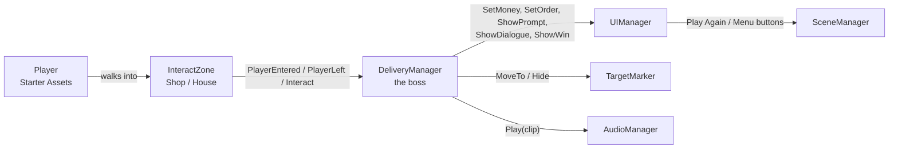

# Pizzaer — Architecture

This document explains **how the game is built**: scenes, folders, scripts, prefabs, and how scripts talk to each other.
Read it once fully. Then keep it open when you work.

New words:
- **Scene** — one "level" file in Unity (`.unity`). We have 2.
- **Prefab** — a saved GameObject you can reuse (`.prefab`). Change the prefab, and every copy changes.
- **Prefab Variant** — a prefab based on another prefab. You change a few things and keep the rest.
- **Component** — a part on a GameObject (Collider, script, AudioSource…).
- **Trigger** — a collider with **Is Trigger** ticked. You walk through it, and Unity tells the script.
- **Singleton** — a script that has only one copy in the scene, so others can find it with `ClassName.Instance`.

Rules for names, tags, owners, and merging are in **[WORK_RULES.md](WORK_RULES.md)**.

---

## 1. Scenes

| Scene | File | Owner | What is in it |
|---|---|---|---|
| Main Menu | `Assets/_Pizzaer/Scenes/MainMenu.unity` | Soth | Title panel, story panel, buttons |
| Town | `Assets/_Pizzaer/Scenes/Town.unity` | **Dina only** | The map + all gameplay prefabs |
| Sandbox scenes | `Assets/_Pizzaer/Scenes/Sandbox/Sandbox_<Name>.unity` | Each person | Your own test area. Nobody else opens it. |

**Build order** (File → Build Profiles → Scene List): `0 MainMenu`, `1 Town`. Sandbox scenes are **not** in the build.

**Why sandbox scenes?** Two people editing the same scene = lost work (scene files can't be merged well). So you test your work in **your** sandbox. Only Dina puts things into `Town`.

### Town scene hierarchy (Dina keeps it like this)

```
Town
├── --- SETUP ---
│   ├── Directional Light
│   ├── Global Volume
│   └── EventSystem
├── --- ENVIRONMENT ---
│   ├── Roads
│   ├── Buildings
│   ├── Env_PizzaShop          (has Zone_Shop inside)
│   ├── Houses
│   │   ├── Env_House_01       (has Zone_House inside, houseNumber = 1)
│   │   └── ... Env_House_05
│   ├── Park
│   ├── Props
│   └── MapBorders
├── --- GAMEPLAY ---
│   ├── Core_GameManager       (DeliveryManager)
│   ├── Core_Audio             (AudioManager + music)
│   ├── Marker_Target          (TargetMarker)
│   └── Player_Pizzaer         (player + cameras)
└── --- UI ---
    └── UI_Canvas              (UIManager)
```

The `--- NAME ---` objects are empty GameObjects used as **folders** in the Hierarchy. Keep them at position (0,0,0).

---

## 2. Folder structure

Only these folders are **ours**. Everything else under `Assets/` was imported from asset packs.

```
Assets/
├── _Pizzaer/                ← ALL our work goes here (the "_" keeps it at the top)
│   ├── Scenes/
│   │   ├── MainMenu.unity
│   │   ├── Town.unity
│   │   └── Sandbox/         ← Sandbox_Dina, Sandbox_Viset, Sandbox_Panha, Sandbox_Soth
│   ├── Scripts/
│   │   ├── Core/            ← DeliveryManager, DeliveryOrder
│   │   ├── Gameplay/        ← InteractZone, TargetMarker
│   │   ├── UI/              ← UIManager, MainMenu
│   │   └── Audio/           ← AudioManager
│   ├── Prefabs/
│   │   ├── Core/            ← Core_GameManager, Core_Audio
│   │   ├── Player/          ← Player_Pizzaer
│   │   ├── Gameplay/        ← Zone_Shop, Zone_House, Marker_Target, NPC_Customer
│   │   ├── Environment/     ← Env_PizzaShop, Env_House_01..05, Env_ signs and props
│   │   └── UI/              ← UI_Canvas
│   ├── Models/              ← 3D models we use (copied from Kenney packs: FBX + Textures)
│   ├── Materials/           ← M_ materials we make (marker glow, ground…)
│   ├── Art/UI/              ← SPR_ sprites from Kenney UI pack
│   └── Audio/
│       ├── Music/           ← MUS_ files
│       └── SFX/             ← SFX_ files
├── StarterAssets/           ← imported from Unity (don't edit files here)
└── (other imported packs)   ← don't edit files here
```

**Rule:** never edit files inside imported packs. Make a **Prefab Variant** or a copy inside `_Pizzaer/` and change that.

Day 1 cleanup: delete `Assets/TutorialInfo/`, `Assets/Readme.asset`, and `Assets/Scenes/SampleScene.unity` (template files we don't need).

---

## 3. Prefab list

| Prefab | Folder | Owner | Components on the root | Notes |
|---|---|---|---|---|
| `Player_Pizzaer` | Prefabs/Player | Viset | Variant of Starter Assets player | Tag **Player**. Includes MainCamera + PlayerFollowCamera. |
| `Zone_Shop` | Prefabs/Gameplay | Viset | BoxCollider (Is Trigger), `InteractZone` (type = Shop) | Tag **Zone**. Placed at the shop door. |
| `Zone_House` | Prefabs/Gameplay | Viset | BoxCollider (Is Trigger), `InteractZone` (type = House) | Tag **Zone**. `houseNumber` is set per house by Dina. |
| `Marker_Target` | Prefabs/Gameplay | Viset | `TargetMarker` + child glowing cylinder | No collider. |
| `NPC_Customer` | Prefabs/Gameplay | Viset | Kenney mini character, idle animation | Nice-to-have. |
| `Core_GameManager` | Prefabs/Core | Panha | `DeliveryManager` | Holds the 5 orders. |
| `Core_Audio` | Prefabs/Core | Soth | `AudioManager`, 2 AudioSources (Music, SFX) | Soth assigns clips. |
| `UI_Canvas` | Prefabs/UI | Soth | Canvas, Canvas Scaler, `UIManager` | Contains HUD, dialogue, win panel. |
| `Env_PizzaShop` | Prefabs/Environment | Dina | Building model + sign + `Zone_Shop` child | |
| `Env_House_01`…`05` | Prefabs/Environment | Dina | Building model + number sign + `Zone_House` child | |

**"Who attaches the script?"** The **owner of the prefab** adds the script component and drags the references. The script writer explains how in the pull request.

---

## 4. Script list

All scripts are in `Assets/_Pizzaer/Scripts/`. File name = class name.

| Script | Folder | Owner | Goes on | Job |
|---|---|---|---|---|
| `DeliveryOrder.cs` | Core | Panha | — (data class, not a component) | Data for 1 order: house number, pizza name, customer name, customer line, reward |
| `DeliveryManager.cs` | Core | Panha | `Core_GameManager` | **The boss.** Keeps the order list, which order is next, "has pizza?", money. Decides what happens when the player presses E. |
| `InteractZone.cs` | Gameplay | Viset | `Zone_Shop`, `Zone_House` | Notices when the player walks in/out and presses E. Tells DeliveryManager. |
| `TargetMarker.cs` | Gameplay | Viset | `Marker_Target` | Moves above the next target, spins. Can hide. |
| `UIManager.cs` | UI | Panha | `UI_Canvas` | Shows money, order text, "Press E", dialogue, win panel. Has button functions. |
| `MainMenu.cs` | UI | Viset | Canvas in `MainMenu` scene | Play / Start / Quit buttons, loads `Town`. |
| `AudioManager.cs` | Audio | Viset | `Core_Audio` | Plays sound effects. Music plays by itself (AudioSource with Loop). |

Player movement uses **Starter Assets** scripts (`ThirdPersonController`, `StarterAssetsInputs`). We **don't** write movement code.

---

## 5. How scripts talk to each other

**Main rule: messages go one way.**
Zones → **DeliveryManager** → UI / Marker / Audio.
The UI never decides game rules. Zones never change the UI directly.



How they **find** each other (no dragging between prefabs needed):
- `DeliveryManager.Instance` — singleton. Zones call it.
- `DeliveryManager` finds the others at Start with `FindFirstObjectByType<UIManager>()`, `FindFirstObjectByType<TargetMarker>()`, and finds all zones with `FindObjectsByType<InteractZone>(...)`.
- `AudioManager.Instance` — singleton.

This means each prefab works alone. Dina just drops them into the scene.

### One full delivery, step by step

1. Game starts. DeliveryManager finds the shop and the 5 houses. The UI shows "Go to the Pizza Shop" and the marker moves over the shop.
2. Player walks into `Zone_Shop` → `InteractZone.OnTriggerEnter` → `DeliveryManager.PlayerEntered(zone)` → UI shows "Press E".
3. Player presses E → `DeliveryManager.Interact(zone)`:
   - sets `hasPizza = true`
   - UI dialogue: *Chef: "Go to House #1 to deliver a Cheese pizza!"*
   - UI order text: "Deliver Cheese pizza to House #1"
   - marker moves over House #1, and the pickup sound plays
4. Player walks into House #1 zone and presses E → `Interact(zone)`:
   - right house + has pizza → money += reward, UI dialogue shows the customer line, deliver sound, next order
   - wrong house → *"Sorry, I didn't order pizza."*
5. After order 5 → marker hides → `UIManager.ShowWin(money)`.

---

## 6. Tags and layers

| Tag | Used on | Why |
|---|---|---|
| `Player` (built-in) | Root of `Player_Pizzaer` (the object with CharacterController) | `InteractZone` checks `CompareTag("Player")` |
| `Zone` (we add it) | Root of `Zone_Shop`, `Zone_House` | Easy to find and check zones in the Hierarchy |

**Layers:** everything stays on **Default**. The Starter Assets ground check uses Default. Don't add layers without asking Dina.

---

## 7. Important beginner traps (read this!)

1. **New Input System only.** Our project uses the new Input System. `Input.GetKeyDown(...)` (old way) gives an **error**. Use:
   `Keyboard.current.eKey.wasPressedThisFrame` (add `using UnityEngine.InputSystem;`).
2. **Trigger not working?** Check: zone BoxCollider has **Is Trigger** ✔, player root has tag **Player**, and the zone is big enough (about 3 × 2 × 3).
3. **Pink models** = material does not match URP. Use **Window → Rendering → Render Pipeline Converter → Material Upgrade**.
4. **Cursor is locked** by Starter Assets. On the Win panel we unlock it in `ShowWin()`. In MainMenu we unlock it in `Start()`.
5. **Time.timeScale = 0** freezes the game on Win. Always set it back to **1** before loading a scene (already in the starter code).
6. `FindFirstObjectByType` does **not** find **inactive** objects. Keep `UI_Canvas`, `Marker_Target`, and zones **active** in the scene. (Panels inside the canvas can be inactive.)
7. **Text:** use **TextMeshPro** (`TMP_Text`), not the old `Text`. The first time, Unity asks to import "TMP Essentials" — click Import.
8. **Unity version differences:** if Unity shows a yellow "obsolete" warning on a line of the starter code (for example `FindObjectsSortMode`), use the new method Unity suggests in the warning.
9. **Never rename or move files outside Unity** (in Windows Explorer). The `.meta` file gets lost and links break. Always move inside the Unity Project window.

---

## 8. Starter code

This is a working starting point. **Type it yourself** (don't just copy-paste) so you understand each line. You can improve it, but **keep the public method names** — other scripts use them.

### `DeliveryOrder.cs` (Panha)

```csharp
using UnityEngine;

// Data for one delivery. Not a component — it shows as a list in DeliveryManager.
[System.Serializable]
public class DeliveryOrder
{
    public int houseNumber = 1;
    public string pizzaName = "Cheese";
    public string customerName = "Customer";
    [TextArea] public string customerLine = "Thank you!";
    public int reward = 10;
}
```

### `DeliveryManager.cs` (Panha)

```csharp
using System.Collections.Generic;
using UnityEngine;

// The "boss" of the game. Only one in the scene (on Core_GameManager).
public class DeliveryManager : MonoBehaviour
{
    public static DeliveryManager Instance;

    [Header("Orders (fill 5 in the Inspector)")]
    public List<DeliveryOrder> orders = new List<DeliveryOrder>();

    [Header("Text")]
    public string chefName = "Chef Lim";

    [Header("Runtime (read only)")]
    public int money = 0;
    public int currentIndex = 0;
    public bool hasPizza = false;

    UIManager ui;
    TargetMarker marker;
    InteractZone shop;
    Dictionary<int, InteractZone> houses = new Dictionary<int, InteractZone>();

    void Awake()
    {
        Instance = this;
    }

    void Start()
    {
        ui = FindFirstObjectByType<UIManager>();
        marker = FindFirstObjectByType<TargetMarker>();

        // Find the shop and all houses in the scene.
        foreach (InteractZone zone in FindObjectsByType<InteractZone>(FindObjectsSortMode.None))
        {
            if (zone.zoneType == ZoneType.Shop) shop = zone;
            else houses[zone.houseNumber] = zone;
        }

        if (shop == null || ui == null || marker == null)
        {
            Debug.LogError("[Delivery] Missing shop zone, UI_Canvas or Marker_Target in the scene!");
            return;
        }

        ui.SetMoney(money);
        ui.SetOrder("Go to the Pizza Shop to get your first order.");
        marker.MoveTo(shop.transform);
    }

    // Called by InteractZone when the player walks in.
    public void PlayerEntered(InteractZone zone)
    {
        ui.ShowPrompt(true);
    }

    // Called by InteractZone when the player walks out.
    public void PlayerLeft(InteractZone zone)
    {
        ui.ShowPrompt(false);
    }

    // Called by InteractZone when the player presses E inside a zone.
    public void Interact(InteractZone zone)
    {
        if (currentIndex >= orders.Count) return; // game already finished

        DeliveryOrder order = orders[currentIndex];

        if (zone.zoneType == ZoneType.Shop)
        {
            if (hasPizza)
            {
                ui.ShowDialogue(chefName, "You already have a pizza. Go deliver it!");
                return;
            }

            hasPizza = true;
            ui.ShowDialogue(chefName, "Go to House #" + order.houseNumber + " to deliver a " + order.pizzaName + " pizza!");
            ui.SetOrder("Deliver " + order.pizzaName + " pizza to House #" + order.houseNumber);

            if (houses.ContainsKey(order.houseNumber))
                marker.MoveTo(houses[order.houseNumber].transform);
            else
                Debug.LogError("[Delivery] House #" + order.houseNumber + " is not in the scene!");
        }
        else // House
        {
            if (!hasPizza || zone.houseNumber != order.houseNumber)
            {
                ui.ShowDialogue("House #" + zone.houseNumber, "Sorry, I didn't order pizza.");
                return;
            }

            hasPizza = false;
            money += order.reward;
            ui.SetMoney(money);
            ui.ShowDialogue(order.customerName, order.customerLine);
            currentIndex++;

            if (currentIndex >= orders.Count)
            {
                marker.Hide();
                ui.ShowWin(money);
            }
            else
            {
                ui.SetOrder("Go back to the Pizza Shop for the next order.");
                marker.MoveTo(shop.transform);
            }
        }
    }
}
```

### `InteractZone.cs` (Viset)

```csharp
using UnityEngine;
using UnityEngine.InputSystem;

public enum ZoneType { Shop, House }

// Put on Zone_Shop and Zone_House (root needs a BoxCollider with Is Trigger ON).
[RequireComponent(typeof(BoxCollider))]
public class InteractZone : MonoBehaviour
{
    public ZoneType zoneType = ZoneType.House;

    [Tooltip("Only for houses. Must match the number on the house sign.")]
    public int houseNumber = 1;

    bool playerInside = false;

    void OnTriggerEnter(Collider other)
    {
        if (!other.CompareTag("Player")) return;
        playerInside = true;
        DeliveryManager.Instance.PlayerEntered(this);
    }

    void OnTriggerExit(Collider other)
    {
        if (!other.CompareTag("Player")) return;
        playerInside = false;
        DeliveryManager.Instance.PlayerLeft(this);
    }

    void Update()
    {
        if (!playerInside) return;
        if (Keyboard.current == null) return;

        if (Keyboard.current.eKey.wasPressedThisFrame)
        {
            DeliveryManager.Instance.Interact(this);
        }
    }
}
```

### `TargetMarker.cs` (Viset)

```csharp
using UnityEngine;

// A glowing pillar that floats above the next place to go.
public class TargetMarker : MonoBehaviour
{
    public float height = 4f;       // how high above the target
    public float spinSpeed = 90f;   // degrees per second
    public float bobAmount = 0.3f;  // up/down movement
    public float bobSpeed = 2f;

    Vector3 basePosition;

    void Awake()
    {
        basePosition = transform.position;
    }

    // Move above a target and show the marker.
    public void MoveTo(Transform target)
    {
        basePosition = target.position + Vector3.up * height;
        transform.position = basePosition;
        gameObject.SetActive(true);
    }

    // Hide the marker (game finished).
    public void Hide()
    {
        gameObject.SetActive(false);
    }

    void Update()
    {
        transform.Rotate(0f, spinSpeed * Time.deltaTime, 0f);
        transform.position = basePosition + Vector3.up * Mathf.Sin(Time.time * bobSpeed) * bobAmount;
    }
}
```

### `UIManager.cs` (Panha writes it, Soth attaches it to `UI_Canvas`)

```csharp
using System.Collections;
using TMPro;
using UnityEngine;
using UnityEngine.SceneManagement;

// Shows everything on screen in the Town scene. Lives on UI_Canvas.
public class UIManager : MonoBehaviour
{
    [Header("HUD")]
    public TMP_Text moneyText;
    public TMP_Text orderText;
    public GameObject promptPanel;      // "Press E"

    [Header("Dialogue")]
    public GameObject dialoguePanel;
    public TMP_Text speakerText;
    public TMP_Text lineText;
    public float dialogueSeconds = 3f;

    [Header("Win")]
    public GameObject winPanel;
    public TMP_Text winMoneyText;

    Coroutine hideRoutine;

    void Awake()
    {
        promptPanel.SetActive(false);
        dialoguePanel.SetActive(false);
        winPanel.SetActive(false);
    }

    public void SetMoney(int amount)
    {
        moneyText.text = "$" + amount;
    }

    public void SetOrder(string text)
    {
        orderText.text = text;
    }

    public void ShowPrompt(bool show)
    {
        promptPanel.SetActive(show);
    }

    // Show a line of dialogue, then hide it after a few seconds.
    public void ShowDialogue(string speaker, string line)
    {
        speakerText.text = speaker;
        lineText.text = line;
        dialoguePanel.SetActive(true);

        if (hideRoutine != null) StopCoroutine(hideRoutine);
        hideRoutine = StartCoroutine(HideDialogueLater());
    }

    IEnumerator HideDialogueLater()
    {
        yield return new WaitForSecondsRealtime(dialogueSeconds);
        dialoguePanel.SetActive(false);
    }

    public void ShowWin(int totalMoney)
    {
        winMoneyText.text = "Shop saved! You earned $" + totalMoney + "!";
        promptPanel.SetActive(false);
        winPanel.SetActive(true);

        Cursor.lockState = CursorLockMode.None; // let the player click buttons
        Cursor.visible = true;
        Time.timeScale = 0f;                     // freeze the game
    }

    // Button: Play Again
    public void PlayAgain()
    {
        Time.timeScale = 1f;
        SceneManager.LoadScene("Town");
    }

    // Button: Main Menu
    public void BackToMenu()
    {
        Time.timeScale = 1f;
        SceneManager.LoadScene("MainMenu");
    }
}
```

### `MainMenu.cs` (Viset writes it, Soth attaches it in `MainMenu` scene)

```csharp
using UnityEngine;
using UnityEngine.SceneManagement;

public class MainMenu : MonoBehaviour
{
    public GameObject titlePanel;
    public GameObject storyPanel;

    void Start()
    {
        Cursor.lockState = CursorLockMode.None;
        Cursor.visible = true;
        Time.timeScale = 1f;
        titlePanel.SetActive(true);
        storyPanel.SetActive(false);
    }

    // Button: Play (on title panel) -> show the story
    public void OnPlay()
    {
        titlePanel.SetActive(false);
        storyPanel.SetActive(true);
    }

    // Button: Start (on story panel) -> load the town
    public void OnStartGame()
    {
        SceneManager.LoadScene("Town");
    }

    // Button: Quit (works only in a build, not in the Editor)
    public void OnQuit()
    {
        Application.Quit();
    }
}
```

### `AudioManager.cs` (Viset writes it, Soth attaches it to `Core_Audio`)

```csharp
using UnityEngine;

// Plays short sound effects. Music is a separate AudioSource with Loop + Play On Awake.
public class AudioManager : MonoBehaviour
{
    public static AudioManager Instance;

    public AudioSource sfxSource;

    [Header("Clips")]
    public AudioClip pickupClip;
    public AudioClip deliverClip;
    public AudioClip wrongClip;
    public AudioClip winClip;

    void Awake()
    {
        Instance = this;
    }

    public void Play(AudioClip clip)
    {
        if (clip != null) sfxSource.PlayOneShot(clip);
    }
}
```

Then Panha adds sound calls inside `DeliveryManager.Interact`, for example:

```csharp
if (AudioManager.Instance != null) AudioManager.Instance.Play(AudioManager.Instance.pickupClip);
```

---

## 9. How to test your work alone (Sandbox scene)

Your `Sandbox_<Name>.unity` should have:
1. A big Plane as ground (scale 10, 1, 10)
2. `Player_Pizzaer` (after Viset's PR is merged; before that, use the Starter Assets player)
3. `Core_GameManager` with 2 test orders
4. `UI_Canvas` and `Marker_Target` (when ready)
5. Two cubes: one with `Zone_Shop`, one with `Zone_House` (houseNumber = 1)

If the loop works in your sandbox, it will work in Town.

## 10. Milestone 2 plan (later)

- Add `GameTimer.cs` on `Core_GameManager` (owner decided later). It counts down and calls `UIManager.SetTimer(seconds)`.
- When time is 0 → `UIManager.ShowLose()`.
- DeliveryManager does not change much. That's the benefit of the "one boss" design.
